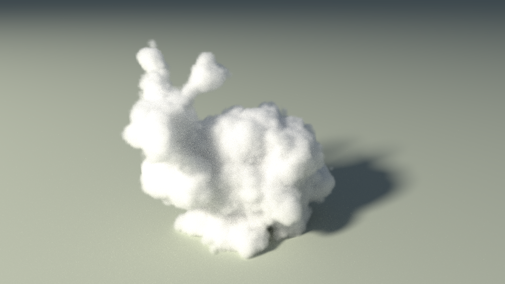
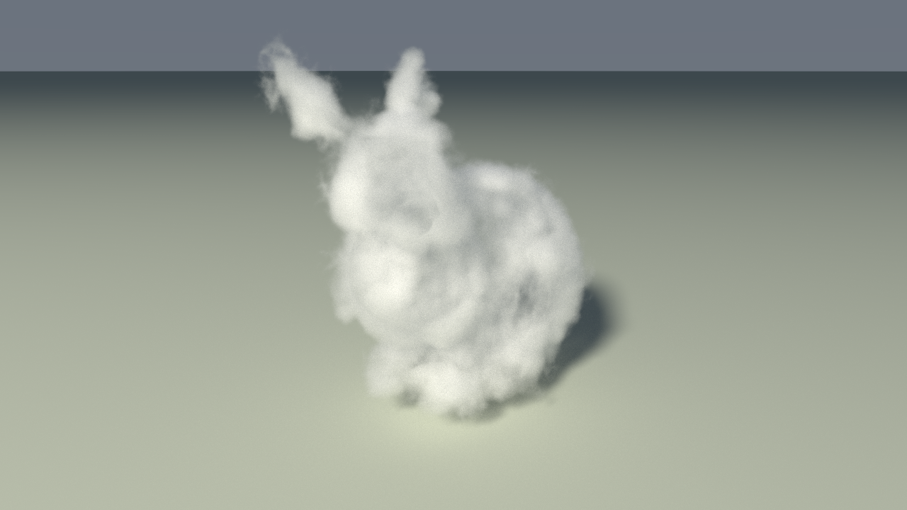

# Nuages et fumée : milieu participant hétérogène (matériau `volume`)

Octobre 2026. Ce document résume le travail réalisé pour rendre le lapin de Stanford comme un
nuage dans RayON, l'état actuel du code, ses limites, et une proposition de projet de semestre
qui prolonge ce travail avec des données de simulation (OpenVDB / NanoVDB).

Référence visée : l'image « bunny cloud » du livre *Physically Based Rendering*, 4e édition,
chapitre *Volume Scattering* :
<https://pbr-book.org/4ed/Volume_Scattering/bunny-cloud-ground-shadow.png>

Explication illustrée (pipeline mesh → grille de densité → delta tracking, deux schémas) :
**<https://claude.ai/artifact/WM1xiVjLv1fVZ8znqjpT4R>** (artifact « Lapin de fumée », partagé
au sein de l'organisation HES-SO ; demander l'accès à P.-A. Mudry sinon).



```bash
# depuis build/
./rayon -m 5 --scene ../resources/scenes/17_cloud_bunny.yaml          # interactif, section GUI "Cloud / Smoke"
./rayon -m 4 -s 512 -r 720 --scene ../resources/scenes/17_cloud_bunny.yaml   # hors ligne
```

---

## 1. Ce qui a été réalisé

### 1.1 Le matériau `volume`

Un nouveau type de matériau, `VOLUME` (YAML : `volume`, `smoke` ou `cloud`), transforme
l'intérieur d'un mesh fermé en milieu diffusant. Le mesh ne sert qu'à donner la forme : le
renderer ne voit jamais sa surface comme une surface à ombrer.

| Paramètre YAML   | Rôle                                                                | Lapin nuage |
|------------------|---------------------------------------------------------------------|-------------|
| `albedo`         | albédo de diffusion simple (part diffusée plutôt qu'absorbée)        | 0.99        |
| `density`        | coefficient d'extinction σ_t par unité de scène                      | 30          |
| `g`              | anisotropie de la fonction de phase Henyey-Greenstein                | 0.5         |
| `noise_scale`    | fréquence du bruit (forme et intérieur)                              | 1.2         |
| `noise_strength` | modulation de la densité intérieure par un fBm (0 = homogène)        | 0.2         |
| `edge`           | profondeur sur laquelle la densité monte depuis la surface déplacée  | 0.05        |
| `lumps`          | amplitude (± unités) du déplacement de la surface par le bruit       | 0.3         |
| `billow`         | part de bruit de Worley inversé (bourgeons de chou-fleur) dans la forme | 0.85     |

Format complet : `resources/scenes/SCENE_FORMAT.md`, section `volume`.
Les paramètres sont modifiables en direct dans la GUI (section « Cloud / Smoke », qui n'apparaît
que si la scène contient un tel matériau) ; le champ de densité est recuit à chaque changement.

### 1.2 Fabrication de la forme (hors du path tracer)

Au chargement de la scène, pour chaque matériau `volume` :

1. **Grille de distance signée** du mesh (`volume_sdf.cu`, `buildVolumeSDF`) : 64 cellules sur
   le plus grand côté d'une boîte englobante élargie de `VOLUME_BOX_PAD = 0.75` unité. Force brute
   sur GPU : chaque voxel teste chaque triangle (distance point-triangle exacte, signe par parité
   d'un rayon en +x). Stockée en texture 3D flottante.
2. **Bruit de forme** (`volume_medium.cuh`, `volume_field_procedural`) : la surface est déplacée
   de ± `lumps` le long d'un bruit mélangeant un fBm de bruit de valeur (4 octaves) et un Worley
   inversé sur 5 octaves (amplitude ÷ 2 par octave). La densité monte ensuite linéairement sur
   `edge` unités depuis cette surface déplacée, puis est modulée à l'intérieur par
   `1 + noise_strength · (2 fBm − 1)`.
3. **Champ recuit** (`bakeVolumeField`) : le résultat (shape × intérieur) est évalué une fois sur
   une grille de `VOLUME_FIELD_CELLS = 160` cellules (plus grand côté) et stocké en texture 3D.
   Les boucles de tracking paient alors une lecture de texture par pas au lieu de ~30
   évaluations de bruit (le Worley 5 octaves coûtait 10× le temps de rendu).

Le pipeline est donc exactement celui de la figure 1 de l'artifact : **le renderer ne lit qu'une
grille de densité**. C'est ce qui rend l'étape « données VDB » du projet naturelle : on remplace la
grille procédurale par une grille mesurée ou simulée, sans toucher au transport de lumière.

### 1.3 Transport de lumière dans le milieu (OptiX et CUDA)

Dans `optix_programs.cu` (raygen, bloc `VOLUME`) et `cuda_raytracer.cuh` (même logique) :

- **Delta tracking** (null collisions contre le majorant `density · (1 + noise_strength)`) pour
  tirer les distances de vol libre. Jusqu'à `VOLUME_MAX_EVENTS = 96` diffusions par chemin, roulette
  russe après 8 événements. Une traversée sans diffusion ne compte pas comme un rebond.
- **Saut d'espace vide** : hors du mesh, au-delà de la portée des bosses, la grille de distance
  borne la distance sur laquelle la densité reste nulle (|∇sdf| ≤ 1) ; on saute d'un coup au lieu
  d'enchaîner des collisions nulles (sauts < 0.02 ignorés pour éviter un rampement de Zénon).
- **Fonction de phase Henyey-Greenstein** (`hg_phase`, `hg_sample_cos`).
- **NEE volumique** (next event estimation) à chaque diffusion : on échantillonne une lumière,
  on pondère par la phase et par la **transmittance** vers la lumière estimée par **ratio tracking**
  (`ratio_track_*`, `shadow_transmittance_*`). C'est ce qui donne l'auto-ombrage du nuage.
  Dès qu'un volume est présent, *tous* les rayons d'ombre de la scène (surfaces comprises)
  deviennent des rayons de transmittance : le sol reçoit l'ombre douce du nuage.
- **MIS** phase ↔ lumière (heuristique de puissance), avec suivi de l'origine du dernier
  événement (`mis_origin`) pour pondérer une lumière touchée en sortant du volume.
- Démarrage **à l'intérieur** du milieu (caméra, ou surface située dans la boîte comme le sol) :
  un premier impact sur une face arrière lance la marche depuis l'origine du rayon.

### 1.4 Intégration dans OptiX

Un matériau `volume` avec `edge > 0` n'est pas tracé via ses triangles : `buildGAS` les remplace
par les **12 triangles d'une boîte** élargie de `VOLUME_BOX_PAD` autour du mesh. La forme réelle
ne vient que de la grille de distance et du bruit, et les bosses peuvent dépasser le mesh.
Le backend CUDA garde le mesh comme frontière (pas de boîte) ; il compile et fonctionne, mais il
est trop lent pour les nuages et n'est plus la cible de ce travail.

### 1.5 Autres changements faits en chemin

- `background_color` du YAML enfin lu par les deux backends (couleur du haut du dégradé de ciel).
- Lumières sphériques : la distance de l'échantillon NEE visait le centre au lieu de la surface,
  le rayon d'ombre touchait l'émetteur lui-même et la lumière ne contribuait jamais via NEE.
- Sol derrière une face de la boîte : le rayon reprenait 0.002 unité après la sortie avec un
  tmin de 0.001 et sautait le sol s'il était dans cette bande (fine ligne sombre au sol).
  Décalages réduits à 0.0002 avec un tmin assorti pour la trace suivante.
- CMake : l'argument vide de `--use_fast_math` en Debug faisait planter la compilation PTX
  (`-lineinfo` en Debug à la place) ; dépendances PTX complétées.
- Denoiser OptiX (IA) pour les images en mouvement, désactivé par défaut (commit `80c8813`).

### 1.6 Route courte réalisée : le lapin VDB par une grille brute

Pour vérifier que le transport de lumière ne dépend pas de la forme procédurale, la « route
courte » du projet (section 3, étape 2) a été faite sans lier OpenVDB au projet : un script
Python rééchantillonne la grille `density` d'un `.vdb` en un tableau dense que RayON charge
directement dans la texture 3D que lisent les boucles de tracking.



- `tools/vdb_to_volume.py` (pyopenvdb + numpy) : lit la grille, la filtre par un facteur
  entier pour tenir dans `--cells` cellules, normalise en [0, 1] et écrit un fichier `.vol`
  (en-tête : résolution, boîte monde, maximum ; puis les valeurs float32, x le plus rapide).
  Format et recette Blender dans `resources/volumes/README.md`.
- `src/rayon/scenes/volume_grid.hpp` : lecteur du format (hôte).
- Clés YAML du matériau `volume` : `grid`, `grid_scale`, `grid_position`. Le loader calcule
  la boîte monde de la grille et l'ajoute comme 12 triangles portant le matériau : aucune
  géométrie à écrire dans la scène. `edge`, `lumps`, `billow` sont ignorés.
- `loadVolumeGrid()` (`volume_sdf.cu`) lie la grille comme champ d'extinction
  (`VolumeParams::field`) sur sa boîte, en mode *border* (0 hors de la boîte). Pas de grille
  de distance : `bakeVolumeField()` laisse le champ tel quel, les curseurs de bruit de la GUI
  sont sans effet. Les deux back ends la lisent : CUDA trace la boîte du loader, OptiX
  remplace cette boîte par la sienne (non rembourrée) comme pour les volumes à mesh.
- `bunny_cloud.vdb` (577×572×438 voxels) est filtré par 2 → 289×286×219 cellules, 72 Mo de
  texture, chargement instantané. Les `.vol` sont ignorés par git (régénérer avec le script).

Coût : 40 s pour 512 spp à 720p contre 11 s pour le lapin procédural, parce qu'un seul
majorant global s'applique à toute la boîte sans saut d'espace vide (la grille de distance
n'existe pas) et que la densité est plus forte (60 contre 30). C'est exactement ce que la
grille de majorants de l'étape 3 corrige.

---

## 2. Limites connues

- **Voxels visibles vers 2000 spp.** Le champ recuit a 160 cellules sur ~8.5 unités, soit
  ~0.05 unité par voxel, lu en trilinéaire : à haute convergence les marches et les bords
  arrondis de voxels se voient, surtout au bord du nuage où le gradient est raide (`edge` 0.05
  est *plus petit* qu'un voxel). La grille de distance (64 cellules) limite aussi la finesse
  du contour. Doubler `VOLUME_FIELD_CELLS` coûte ~8× la mémoire (160³ × 4 o ≈ 16 Mo → 131 Mo
  à 320) et ~1 s de rendu de plus par doublement à 512 spp. Ce point est laissé tel quel :
  c'est le projet ci-dessous qui remplace cette grille.
- **Forme procédurale.** Le bruit donne une silhouette de cumulus crédible mais pas la
  structure d'un écoulement : pas de volutes enroulées, pas de détail cohérent jusqu'au pixel.
  pbrt rend une grille issue d'une simulation.
- Un seul majorant global : dans les zones peu denses on paie beaucoup de collisions nulles.
  Pour les grilles de données (section 1.6) il n'y a même pas de saut d'espace vide : toute
  la boîte est parcourue au majorant, d'où un rendu 3 à 4 fois plus lent que le procédural.
- Pas de milieu émissif (feu), pas d'absorption colorée, pas d'animation.

---

## 3. Proposition de projet de semestre : nuages à partir de données OpenVDB

**Objectif.** Rendre dans RayON des volumes venant de données (fichier `.vdb`), d'abord le
`bunny_cloud.vdb` des modèles d'exemple OpenVDB (celui dont la scène `bunny-cloud` de
pbrt-v4 est dérivée, voir <https://www.openvdb.org/download/>), puis des volumes simulés dans
Blender à partir d'un mesh quelconque. Comparer visuellement et en temps de rendu avec pbrt-v4.

**Pourquoi c'est bien découpé.** Le path tracer ne lit qu'une grille de densité par texture 3D
(`VolumeParams::field`). Un premier résultat s'obtient donc sans toucher aux kernels : charger
un VDB sur CPU, le rééchantillonner dans cette texture, et rendre.

### Étapes proposées

1. **Lecture** (2 semaines). pbrt 4e éd. chap. 11 *Volume Scattering* et chap. 14
   *Light Transport II: Volume Rendering* ; Novák et al. 2018, *Monte Carlo Methods for
   Volumetric Light Transport Simulation* (état de l'art, delta/ratio tracking) ; la doc
   NanoVDB (<https://github.com/AcademySoftwareFoundation/openvdb/tree/master/nanovdb>).
   Lire `volume_medium.cuh` et le bloc `VOLUME` de `optix_programs.cu` en parallèle de
   l'artifact.
2. **Route courte : VDB → texture 3D** (1 semaine, déjà faite en version minimale, section
   1.6). Reproduire le lapin VDB (`tools/vdb_to_volume.py`, scène `19_vdb_bunny.yaml`),
   comprendre le format `.vol` et le chemin grille → `VolumeParams::field`, puis comparer avec
   pbrt-v4 sur la même scène (`bunny-cloud`). Améliorations possibles sans toucher aux
   kernels : lire le `.vdb` directement en C++ (lier OpenVDB, ou NanoVDB seul qui lit les
   `.nvdb` sans dépendance), rééchantillonnage trilinéaire au lieu du filtre entier, stockage
   en `half` ou `uint8` pour diviser la mémoire par 2 ou 4.
3. **NanoVDB sur GPU** (3 semaines). Échantillonner la grille NanoVDB directement dans le
   kernel (`nanovdb::SampleFromVoxels`, interpolation trilinéaire), sans rééchantillonnage ni
   perte de résolution. Ajouter une **grille de majorants** grossière (par ex. 16³ ou tuiles
   8³ du VDB) parcourue par DDA : le delta tracking utilise le majorant local, ce qui remplace
   le saut d'espace vide basé sur la distance signée et accélère beaucoup les zones diffuses.
4. **Blender → RayON** (2 semaines). Dans Blender : *Quick Smoke* sur un mesh (le lapin,
   ou n'importe quel objet), cuisson, cache au format OpenVDB (`fluid_data_XXXX.vdb` dans le
   dossier de cache du domaine), conversion `.nvdb`, rendu dans RayON. Variante sans
   simulation : modificateurs *Mesh to Volume* + *Volume Displace* (la version Blender de
   notre pipeline procédural), export via un script Python et `pyopenvdb`. Documenter la
   recette pas à pas.
5. **Extensions** (selon avancement). Séquence de VDB pour une animation (une grille par
   image, précharger en mémoire GPU) ; grille `temperature` → émission (feu) ; extinction
   colorée ; mesure du coût (événements par chemin, collisions nulles, temps par spp) et
   comparaison avec pbrt-v4 sur la même scène.

### Livrables

- Code intégré dans RayON (scène YAML d'exemple, format documenté dans `SCENE_FORMAT.md`,
  section GUI « Cloud / Smoke » adaptée : les paramètres de forme n'ont plus de sens pour
  un VDB, `density`, `albedo`, `g` restent).
- Comparaison d'images pbrt-v4 / RayON (`bunny-cloud`), et tableau de temps de rendu.
- Recette Blender reproductible et deux ou trois volumes simulés rendus.
- Rapport : théorie (delta/ratio tracking, NEE volumique, MIS), choix d'implémentation,
  résultats, limites.

### Points d'entrée dans le code

| Fichier                                            | Contenu                                                   |
|----------------------------------------------------|-----------------------------------------------------------|
| `src/rayon/gpu_renderers/volume_params.h`          | `VolumeParams` (densité, bruit, textures sdf/field)        |
| `src/rayon/gpu_renderers/volume_medium.cuh`        | bruits, `volume_density`, `volume_empty_skip`, phase HG    |
| `src/rayon/gpu_renderers/volume_sdf.cu/.cuh`       | grille de distance, recuit du champ (`bakeVolumeField`), `loadVolumeGrid` |
| `src/rayon/scenes/volume_grid.hpp`, `tools/vdb_to_volume.py` | format `.vol` : lecteur hôte et convertisseur VDB |
| `src/rayon/gpu_renderers/optix/optix_programs.cu`  | raygen : bloc `VOLUME`, `ratio_track_optix`, `shadow_transmittance_optix` |
| `src/rayon/gpu_renderers/optix/optix_renderer.cu`  | `buildGAS` (boîte du volume), `optixRendererUpdateMaterial` |
| `src/rayon/gpu_renderers/cuda_raytracer.cuh`       | même logique côté CUDA                                     |
| `src/rayon/scenes/scene_description.hpp`, `yaml_scene_loader.cc` | `MaterialDesc::volume()`, clés YAML          |
| `src/rayon/camera/sdl/sdl_gui_handler.hpp`         | section GUI « Cloud / Smoke » (`VolumeMaterialSettings`)   |
| `resources/scenes/17_cloud_bunny.yaml`             | scène de référence (forme procédurale)                     |
| `resources/scenes/19_vdb_bunny.yaml`, `resources/volumes/README.md` | lapin VDB par grille brute, recette Blender |

### Pièges rencontrés, à connaître

- Toute nouvelle source `.cu` doit être listée dans `CMakeLists.txt`, puis `cmake .. --fresh`.
- Les origines de rayons posées sur les faces de la boîte demandent des epsilons cohérents
  (tmin et décalage) : voir le correctif « sol derrière une face » ci-dessus.
- Une mesure de performance n'a de sens que si aucune autre instance de `rayon` ne tourne.
- Le denoiser et le régulateur de cadence du mode interactif ont un coût par pixel à prendre
  en compte si l'on ajoute des buffers (guides albédo/normale).
