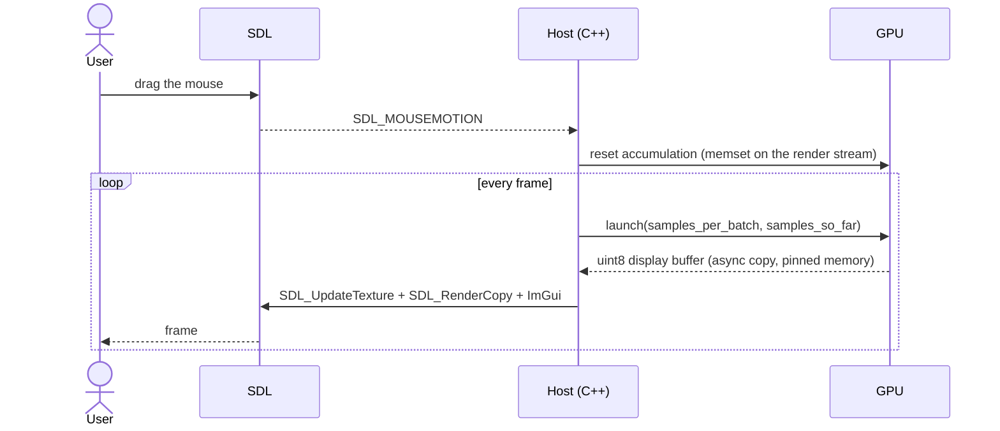
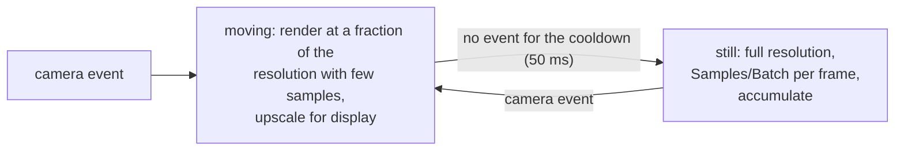

# Progressive Rendering

The interactive modes (3 for CUDA, 5 for OptiX) are where RayON feels most alive. This page
explains how the accumulation loop keeps the window responsive while the image converges, and
how the OptiX renderer holds its frame rate while the camera moves.

---

## Overview

The interactive host (`renderer_optix_progressive_host.hpp`, `renderer_cuda_progressive_host.hpp`)
runs one loop:

1. Poll SDL events: mouse, keyboard, window resize, the Dear ImGui panel.
2. If the camera or a scene parameter changed, **reset the accumulation** (zero the float
   buffer on the device, restart the sample counter).
3. Launch one **batch** of samples per pixel on the GPU and add it to the accumulation buffer.
4. Convert the buffer to the 8-bit display image on the GPU, copy it to pinned host memory,
   upload it to the SDL texture, draw the panel, present.



There is no fixed schedule of sample stages and no pause between batches: as long as the camera
is still, every frame adds **Samples/Batch** samples (8 by default, per-scene override with
`settings.samples_per_batch`), until the accumulation is complete.

---

## Float accumulation on the GPU

The accumulation buffer is a `float4` array of `width × height` that never leaves the device.
Each kernel launch adds its samples to it and keeps the total count; a small gamma kernel then
converts the running mean to 8-bit RGB:

```cpp
float r = sqrtf(accum[i].x / total_samples);   // gamma 2.0 = sqrt
```

Only the 3-byte-per-pixel display image crosses to the host, through an asynchronous copy into
page-locked memory on a dedicated stream, so the next batch can start while the previous frame
is being displayed (see [Optimisations](../how-it-works/optimizations.md), items 7, 11 and 17).

The sampler state (Sobol' index, scramble seed) is also persistent per pixel, and the scramble
is refreshed on every restart so that consecutive accumulations do not replay the same sequence.

---

## When does it stop?

| Condition | Default |
|---|---|
| Adaptive sampling reports 99.9 % of the pixels converged | on |
| The per-pixel budget is reached | 100 000 samples |
| Accumulation paused with **Space** or `--no-auto-accumulate` | — |

### Adaptive sampling

Each pixel tracks its own sample count and the statistics of its value. After 32 samples, a
pixel whose **standard error** in display space falls below the threshold (0.01 of the 0–1
range, about 2.5 levels of 255, adjustable in the GUI) is flagged as converged and skipped by
later batches; the GPU counts the converged pixels with a warp-shuffle reduction so only one
integer comes back to the host. Pixels that are lit only by rare bright paths keep sampling.
The **Show Sample Heatmap** option paints the samples spent per pixel.

---

## Camera motion (OptiX)

A camera move invalidates the accumulation, so during an orbit every frame is a one-batch
image. At full resolution that is a few frames per second on a heavy scene. The OptiX host
therefore trades quality for frame rate **while the camera moves only**:



The **regulator** holds a target frame rate (60 fps by default). It models the cost of a
motion frame from the previous ones and, when the frame rate drops, lowers the render fraction
first (from the ceiling of 3/4 down to a floor of 1/4 of the width and height, that is 1/16 of
the pixels), then the samples per frame (down to a floor of 4). When there is headroom it raises
them back. Every value is a slider in the *Camera Motion* section of the panel; the readout
shows what the last motion frame used.

On top of the regulator, the motion frames can use one sample per pixel, the cheaper PCG
sampler, a capped bounce depth, skip the shadow rays, be despeckled at display time, and be
passed through the **OptiX AI denoiser** (guided by the albedo and normal of the first hit).
The denoiser can keep running over the first still frames with a weight that fades to zero at
64 samples, so the image does not snap from smooth to noisy when the camera stops. Optional
intermediate stages (1/2 then 3/4 resolution, each fading into the previous image) are
available for very heavy scenes.

The CUDA interactive renderer has none of this: it keeps rendering full batches while the
camera moves, with the display-time despeckle as its only concession.

---

## Camera interaction

| Input | Action |
|---|---|
| Left mouse + drag | Orbit around the look-at point |
| Right mouse + drag | Pan the camera and the look-at point |
| Scroll wheel | Zoom |
| **O** | Auto orbit |
| Left / Right | Previous / next scene |

The orbit keeps the camera on a sphere around the look-at point in spherical coordinates;
the pan moves both points along the camera's right and up vectors. Any change restarts the
accumulation; the GUI's **Save camera & lights** button writes the current view into the scene
file.

---

## Live parameter updates

Most sliders change a value that is passed to the next launch and restart the accumulation.
Nothing is rebuilt:

- **OptiX**: background intensity, light intensity and falloff, depth of field, the MIS and
  sampler options are fields of the launch parameters, uploaded (a few hundred bytes) before
  every launch. The cloud sliders rewrite one material record and re-bake its density field.
- **CUDA**: the same values are `__constant__` symbols updated with `cudaMemcpyToSymbol`,
  and the material record is rewritten in place.

Changing the scene rebuilds everything: the acceleration structures, the material and light
tables, the textures and the volume grids.


*The interactive window on the DGX Spark. The panel on the right holds every setting of this
page.*
