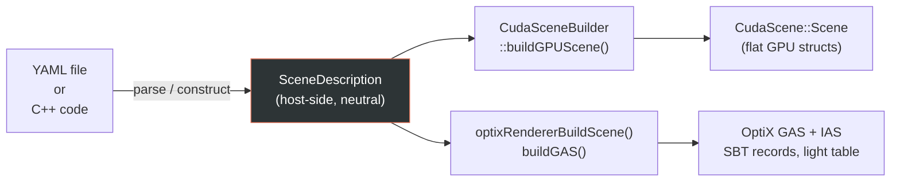

# Scene System

RayON uses a **"build once, render anywhere"** architecture. A single host-side scene description
is constructed once, from YAML or from C++, and handed to whichever GPU back-end renders it.

---

## The core idea

GPU kernels cannot use virtual functions, heap allocation, or polymorphism.
RayON uses one **neutral representation** (`Scene::SceneDescription`) that is converted
into the GPU-specific flat format at build time:



---

## SceneDescription

Defined in `src/rayon/scenes/scene_description.hpp`, `SceneDescription` holds:

- **Materials** — a `std::vector<MaterialDesc>`: a type enum and every parameter any type may
  need (albedo, roughness, complex IOR, film thickness, volume density and noise, grid file…)
- **Geometry** — a `std::vector<GeometryDesc>` with a type enum and a parameters union; an OBJ
  mesh becomes one `TRIANGLE` entry per face
- **BVH nodes** — built by `buildBVH()` with the surface area heuristic, a flat `std::vector<BVHNode>`
- **Camera and settings** — position, look-at, field of view, background colour and intensity,
  light intensity and falloff, batch size, the path of the YAML file the scene came from
- **Textures** — image paths, deduplicated, uploaded once per back-end

### Adding objects programmatically

```cpp
// Create a scene
Scene::SceneDescription scene_desc;

// Add a material
int gold = scene_desc.addMaterial(
    MaterialDesc::roughMirror(Vec3(1.0, 0.85, 0.57), /*roughness=*/0.03)
);

// Add a sphere using that material
scene_desc.addSphere(Vec3(-2.0, 0.5, 0.0), /*radius=*/0.8, gold);

// Add a rectangle area light
int light = scene_desc.addMaterial(MaterialDesc::light(Vec3(5, 4.5, 3.5)));
scene_desc.addRectangle(Vec3(-1, 3, -2), Vec3(2.5, 0, 0), Vec3(0, 0, 1.5), light);

// Enable BVH
scene_desc.use_bvh = true;
```

This is how `scene_factory.hpp` builds the built-in default scene; `yaml_scene_loader.cc` does
the same from a file and can write the camera and light settings back into it.

---

## CUDA scene building

`CudaSceneBuilder::buildGPUScene(desc)` converts the description into **Plain Old Data**
structures the GPU can work with:

```cpp
// From scene_builder_cuda.cu
void convertGeometry(const GeometryDesc& g, CudaScene::Geometry& out) {
    out.type = static_cast<CudaScene::GeometryType>(g.type);
    if (g.type == GeometryType::SPHERE) {
        out.sphere.center = make_float3(g.sphere.center);
        out.sphere.radius = (float)g.sphere.radius;
    }
    // ... other types
}
```

The result is a `CudaScene::Scene` struct containing:

- `Geometry* geometries` — flat array of POD geometry structs
- `Material* materials` — flat array of POD material structs
- `BVHNode* bvh_nodes` — flat array (if BVH is enabled)
- `int num_geometries`, `int num_materials`, `int num_bvh_nodes`

All of these are allocated with `cudaMalloc` and freed after rendering. Volume materials get
their signed distance grid and baked density field built here (`volume_sdf.cu`), as 3D
textures bound into the material.

---

## OptiX scene building

`optixRendererBuildScene()` walks the same description but splits it by how OptiX intersects
things: every `TRIANGLE` goes into one **triangle geometry acceleration structure** handled by
the RT cores, with a per-triangle side table (material, normals, UVs, visibility); spheres,
rectangles, displaced spheres and SDF shapes become **custom primitives** with their own
bounding boxes and a shader binding table record each. A one-level instance acceleration
structure references both. Volumes are traced as a box around their mesh. Lights are collected
into a device table with an area CDF for next event estimation.

!!! info "CPU renderers archived"
    The CPU back-ends and their `CPUSceneBuilder` live on the
    [`legacy/cpu-renderer`](https://github.com/pmudry/RayON/tree/legacy/cpu-renderer) branch.

---

## Type discrimination on the GPU

Without virtual functions, the GPU dispatcher uses switch statements:

```cpp
// From cuda_raytracer.cuh
__device__ bool intersect_geometry(const Geometry& g, const Ray& r, float t_min, float t_max,
                                   HitRecord& rec) {
    switch (g.type) {
        case GeometryType::SPHERE:
            return intersect_sphere(g.sphere, r, t_min, t_max, rec);
        case GeometryType::RECTANGLE:
            return intersect_rectangle(g.rect, r, t_min, t_max, rec);
        case GeometryType::SDF_PRIMITIVE:
            return intersect_sdf(g.sdf, r, t_min, t_max, rec);
        // ...
    }
    return false;
}
```

The same pattern is used for material evaluation:

```cpp
__device__ void scatter_material(const Material& mat, ...) {
    switch (mat.type) {
        case MaterialType::LAMBERTIAN: scatter_lambertian(...); break;
        case MaterialType::ROUGH_MIRROR: scatter_rough_mirror(...); break;
        case MaterialType::GLASS: scatter_glass(...); break;
        // ...
    }
}
```

---

## Memory layout decisions

The `BVHNode` is padded to exactly **64 bytes** — one cache line — so that a single L2 cache
line access fetches one complete node. This is critical for GPU BVH traversal performance,
where tree lookups are the primary memory bottleneck.

For `float` vs. `double`: the host builds everything in `double` precision (standard C++), and
precision is reduced to `float` at the GPU kernel boundary. This choice avoids precision
artefacts in scene geometry construction while keeping GPU compute on `float` lanes.

---

## Adding a new geometry type

1. Add the enum value to `GeometryType` in `scenes/scene_description.hpp`.
2. Add a parameters struct inside the `GeometryDesc` union and a `SceneDescription::addMyShape()`
   factory method that fills the bounds.
3. Add a `CudaScene::Geometry` union member in `cuda_scene.cuh` and the `convertGeometry()` case
   in `scene_builder_cuda.cu`.
4. Implement the intersection in `cuda_raytracer.cuh` (`intersect_geometry()`), ideally in a header
   shared with OptiX as `sdf_primitives.cuh` is.
5. On OptiX, add an `__intersection__` program in `optix_programs.cu`, a program group and the
   SBT record fill in `optix_renderer.cu`, and list the type in `buildGAS()`.
6. Parse it in `yaml_scene_loader.cc` and document it in `SCENE_FORMAT.md`.
