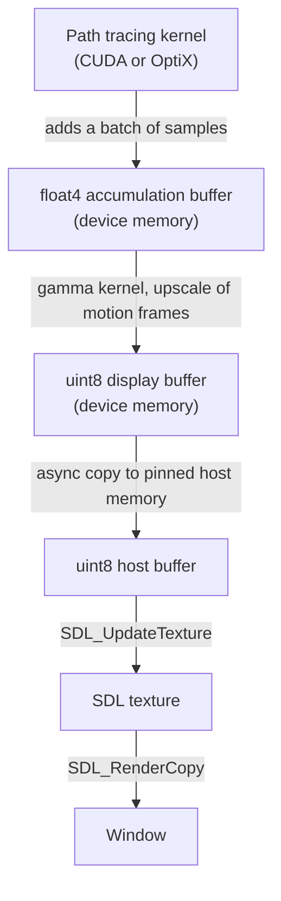

# Interactive Mode

Modes 3 (CUDA) and 5 (OptiX) open an SDL2 window where any scene can be explored in real time:
mouse-driven camera, progressive accumulation, and a Dear ImGui panel holding every rendering
parameter. Mode 5 is the default when the OptiX SDK is available; it is also the one with the
motion regulator and the AI denoiser.

---

## Starting interactive mode

```bash
cd build
./rayon --scene ../resources/scenes/17_cloud_bunny.yaml        # mode 5 (or 3 without OptiX)
./rayon -m 3 --scene ../resources/scenes/09_color_bleed_box.yaml
```

!!! note "SDL2 required"
    The interactive modes exist only when SDL2 was found at CMake configure time. On a remote
    GPU server, run the window through VNC with `scripts/rayon_vnc.sh` (see
    [Getting Started](../getting-started.md)).

---

## Camera controls

| Input | Effect |
|---|---|
| **Left mouse** + drag | Orbit around the look-at point |
| **Right mouse** + drag | Pan the camera and the look-at point |
| **Scroll wheel** | Zoom (distance to the look-at point) |
| **O** | Auto orbit |

Any camera change restarts the accumulation.

## Keyboard shortcuts

| Key | Effect |
|---|---|
| **Space** | Pause or resume the accumulation |
| **Left / Right** | Previous / next scene (every YAML file of `resources/scenes/`) |
| **Numpad + / −** (or **=** / **−**) | Next / previous HDR sky |
| **N** | Toggle the normal visualisation |
| **F** | Toggle the samples-per-second counter |
| **L** | Toggle the logo |
| **H** | Hide / show the panel |
| **Enter** | Collapse / expand the panel window |
| **C** | Collapse / expand every section |
| **R** | Reset the light, material and camera settings to their defaults |
| **Esc** | Quit |

---

## How accumulation works

Each frame adds a batch of **Samples/Batch** samples to every pixel (8 by default; a scene can
set `settings.samples_per_batch`, and `--samples-per-batch` on the command line wins). The
samples go into a float accumulation buffer that stays on the GPU; a small kernel converts it to
the 8-bit display image.

While the camera is still, the renderer keeps adding batches until one of these happens:

- **Adaptive sampling** reports that 99.9 % of the pixels have converged (see below),
- the budget of 100 000 samples per pixel is reached,
- you pause it with **Space**, or started with `--no-auto-accumulate`.

While the camera moves, the OptiX renderer trades quality for frame rate (see
[Camera Motion](#camera-motion-optix) below). The CUDA renderer keeps rendering full batches.

---

## The control panel

The panel sits at the right of the window. Every section is a collapsible header.

### Scene

The scene combo lists every YAML file found in `resources/scenes/`; the arrow keys cycle through
it. The current camera position and look-at point are displayed, and the button
**Save camera & lights to scene YAML** writes them back into the file the scene was loaded from,
together with the light settings. Only the `camera:` lines (`position`, `look_at`, `fov`) and
the `settings:` keys `background_intensity`, `light_intensity`, `light_falloff` (and `indirect_clamp` on OptiX) are rewritten;
comments and everything else are kept. This is how the bundled scenes got their viewpoints.

### Performance Monitoring

Samples per pixel so far, throughput in samples per second, time per pass, and a history graph
of both. A converged-pixel percentage appears when adaptive sampling is on.

### Camera Settings

Field of view, depth of field (aperture and focus distance), auto orbit.

### Environment & Materials

| Control | Effect |
|---|---|
| **Sky** | Built-in gradient or any `.hdr` file of `resources/hdri/` ([HDR Sky Dome](hdr-sky.md)) |
| **Lights inten.** | Multiplier on every light's emission (`settings.light_intensity`) |
| **Lights falloff** | Distance exponent of the lights' reach, 2 = physical ([Lights & Shadows](lighting.md)) |
| **Ambient Light** | Brightness of the sky (`settings.background_intensity`) |
| **Metal Fuzz** | Multiplier on the roughness of rough mirrors |
| **Glass IOR** | Index of refraction of glass materials |

The light and sky values are live: they are launch parameters, no scene rebuild is needed.

### Procedural Patterns

Shown when the scene holds a golf ball (displaced sphere): number, radius and depth of the
dimples.

### Cloud / Smoke

Shown when the scene holds a `volume` material: albedo, density, phase asymmetry, noise scale
and strength, edge, lumps, billow. Every change re-bakes the density field in a few
milliseconds ([Volumes](volumes.md)).

### Adaptive Sampling

| Control | Default | Effect |
|---|---|---|
| **Adaptive Sampling** | on | After 32 samples, a pixel whose standard error falls below the threshold stops taking samples |
| **Threshold** | 0.01 | Standard error of the displayed value, in levels of 255 (about 2.5 levels) |
| **Show Sample Heatmap** | off | Plasma colour map of the samples spent per pixel (purple = few, yellow = many) |

Pixels lit only by rare bright paths are protected from freezing too early. Disable with
`--no-adaptive-sampling`.

### MIS / NEE

**Enable MIS** (master toggle for next event estimation and the MIS weights), **NEE stride**
(beyond the first bounce, shadow rays on 1 of every N samples, 1 by default) and the
**Sobol sampler** checkbox (uncheck for PCG). See [Multiple Importance Sampling](../how-it-works/mis.md).

### Camera Motion (OptiX) { #camera-motion-optix }

Everything in this section applies **only while the camera moves**. The accumulation restarts
on every move, so none of it changes the final image.

| Control | Default | Effect |
|---|---|---|
| **Max while moving** | 3/4 | Highest fraction of the width and height rendered while moving; the frame is upscaled for display |
| **Hold a target frame rate** | on, 60 fps | The regulator lowers the render fraction first, then the samples per frame, until the frame rate holds, and raises them back when there is headroom |
| **Min while moving** | 1/4 | Floor of the render fraction (1/16 of the pixels) |
| **Min samples** | 4 | Floor of the samples per pixel per motion frame; Samples/Batch is the ceiling |
| **Intermediate stages** | off | When the camera stops, climb through 1/2 and 3/4 resolution before full, with a stage length, a fade and a motion cooldown |
| **One sample per frame** | off | Ignore the batch size while moving |
| **Fast sampler (PCG)** | off | PCG instead of Sobol' while moving |
| **Limit bounce depth** | off | Cap the bounces at 4 while moving (about 10 % faster, indirect light slightly darker) |
| **Disable MIS / NEE while moving** | off | Skip the shadow rays while moving (`--motion-gate-mis`) |
| **Despeckle motion frames** | on, ratio 2 | At display time, a pixel far brighter than its 8 neighbours is scaled down; the accumulation is untouched |
| **AI denoiser (OptiX)** | off | Run the OptiX neural denoiser on every motion frame, guided by the albedo and normal of the first hit. Display only. **Fade out until** (64 spp) keeps denoising the first still frames with a weight that fades to zero, so the image does not snap from smooth to noisy |

The readout under the sliders shows the resolution fraction and the samples used by the last
motion frame, and the denoiser time when it runs.

### Appearance

Theme (`light`, `classic`, `nord`, `dracula`, `gruvbox`, `catppuccin`), logo, samples-per-second
counter.

### Controls & Help

The mouse and keyboard reference above.

---

## Display pipeline



Only three bytes per pixel cross from the device to the host each frame, about 6 MB at
1920×1080. The float accumulation buffer never leaves the GPU.

---

## Sample screenshot


*The interactive window after a few seconds of stillness. The panel on the right shows the
sample count, the throughput graph and the live sliders.*
