<div class="hero-banner">
  
  <p class="hero-tagline">A CUDA &amp; OptiX path tracer with real-time progressive sampling, volumetric clouds and ray-marched shapes</p>
</div>

## What is RayON?

RayON is an educational and experimental **path tracer** written in C++17 and CUDA. It started
as a re-implementation of the classic
[Ray Tracing in One Weekend](https://github.com/RayTracing/raytracing.github.io) series and grew
into an interactive renderer that holds **60 frames per second while the camera moves** and
accumulates thousands of samples per pixel when it stops. It is used as teaching material in the
*ISC 302 High-Performance Computing* course at HES-SO Valais.

Two GPU back-ends share one scene description and one GUI, each in an offline and an interactive
flavour. No recompilation is needed to switch between them (`-m 2` to `-m 5`):

<div class="feature-grid" markdown>
<div class="feature-card" markdown>
**OptiX** (hardware ray tracing)

Triangles on the RT cores, custom intersectors for spheres, rectangles and SDF shapes, an AI
denoiser for motion frames and a regulator that trades resolution for frame rate. The default
when the OptiX SDK is found.
</div>
<div class="feature-card" markdown>
**CUDA** (software ray tracing)

One thread per pixel, a BVH traversed with an iterative stack, persistent random states and a
float accumulation buffer that never leaves the GPU. Runs everywhere CUDA runs.
</div>
<div class="feature-card" markdown>
**Interactive mode**

SDL2 window with mouse orbit, pan and zoom, a Dear ImGui panel for every rendering parameter,
scene switching with the arrow keys, HDR skies, and a button that writes the camera and the
light settings back into the scene file.
</div>
</div>

!!! info "CPU renderers archived"
    The original CPU rendering back-ends (sequential and multi-threaded) live on the
    [`legacy/cpu-renderer`](https://github.com/pmudry/RayON/tree/legacy/cpu-renderer) branch.
    The main branch is GPU only.

### What it renders

- **Materials**: Lambertian, mirror, rough mirror, glass, GGX anisotropic conductors with measured
  complex IOR, thin-film interference, clear coat, area and sphere lights, and a **volume** material
  for clouds and smoke (delta tracking, Henyey–Greenstein phase function, volumetric shadow rays).
- **Geometry**: spheres, rectangles, triangles, Wavefront OBJ meshes with MTL materials and UV
  textures, procedurally displaced spheres, ten ray-marched **signed distance primitives**, and
  volumes shaped by a mesh, by procedural noise or by an OpenVDB density grid.
- **Light transport**: next event estimation with multiple importance sampling, a Sobol'
  low-discrepancy sampler with Owen scrambling, Russian roulette, adaptive (converged-pixel)
  sampling, a BVH built with the surface area heuristic.
- **Scenes**: a plain YAML format with 24 bundled examples, from a Cornell box to the
  Stanford bunny as a cumulus cloud.

---

## Sample renders

<div class="img-grid cols-2">
  <figure>
    
    <figcaption><strong>Cloud bunny</strong> — the volume material: a mesh shaped by noise, lit by a sun with volumetric shadow rays. Scene <code>17_cloud_bunny.yaml</code>.</figcaption>
  </figure>
  <figure>
    
    <figcaption><strong>VDB bunny</strong> — the same transport on a density grid from OpenVDB, the reference image of the pbrt book. Scene <code>19_vdb_bunny.yaml</code>.</figcaption>
  </figure>
  <figure>
    
    <figcaption><strong>SDF gallery</strong> — mandelbulb, death star, cut hollow sphere, torus, octahedron, pyramid and friends, sphere-traced on both back-ends. Scene <code>18_sdf_shapes.yaml</code>.</figcaption>
  </figure>
  <figure>
    
    <figcaption><strong>Cornell box</strong> — diffuse colour bleeding and soft shadows from a rectangular area light, resolved by next event estimation.</figcaption>
  </figure>
  <figure>
    
    <figcaption><strong>Anisotropic metals and glass</strong> — GGX microfacet conductors with measured spectral Fresnel next to dielectrics.</figcaption>
  </figure>
  <figure>
    
    <figcaption><strong>Thin film</strong> — soap bubbles and oil slicks from the Airy interference formula.</figcaption>
  </figure>
</div>

---

## Quick start

```bash
# Build (CMake ≥ 3.20, a C++17 compiler, the CUDA toolkit; SDL2 and the OptiX SDK are optional)
mkdir -p build && cd build
cmake .. --fresh
make -j$(nproc)

# Run from build/ — the OptiX programs and the HDR skies are found relative to this directory.
# Interactive OptiX when available, else interactive CUDA, else offline CUDA.
./rayon

# Pick a mode explicitly: 2 = CUDA offline, 3 = CUDA interactive, 4 = OptiX offline, 5 = OptiX interactive
./rayon -m 4 -s 512 -r 1080 --scene ../resources/scenes/17_cloud_bunny.yaml
```

See [Getting Started](getting-started.md) for the full setup, the command-line options and the
list of bundled scenes, or [YAML Scene Format](features/scenes.md) to write your own.

---

## Explore the docs

| Section | What you'll find |
|---|---|
| [How It Works](how-it-works/index.md) | The math: rendering equation, materials, BVH, sampling, Sobol', MIS, optimisations |
| [Architecture](architecture/index.md) | Scene system, CUDA renderer internals, the progressive pipeline |
| [Features](features/index.md) | Interactive mode, YAML scenes, lights, volumes, SDF shapes, OBJ loading, HDR skies |
| [Gallery](gallery.md) | Renders from the bundled scenes |
| [Performance](performance.md) | Benchmarks, speedups, tuning tips |
| [Development History](history.md) | How the project grew, commit by commit |
